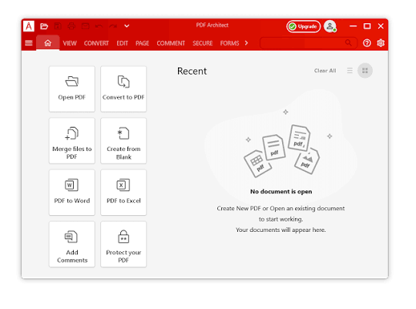
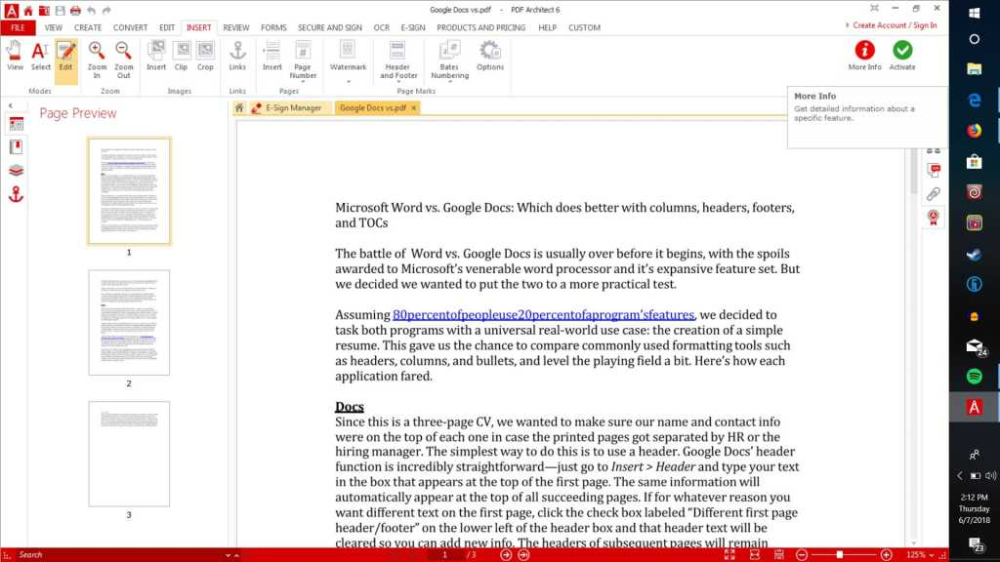

# PDF Architect Pro for Editing Complete Documents

A revised PDF may need a corrected paragraph, a searchable scan, a fillable form, or a different page sequence.
PDF Architect Professional brings these document tasks into a Windows editor; use this guide to plan the result before changing the file.

## Assemble the document before changing its contents

Collect the source PDFs and decide which pages belong in the final document.
Remove duplicated scans, rotate sideways pages, and place attachments beside the sections that explain them.
Keep the original files available while the assembled copy takes shape.

For a compact page-selection example, Python with pikepdf can extract the first and third pages of a sample PDF:

```python
from pikepdf import Pdf

with Pdf.open("tests/exporter/basic.pdf") as source, Pdf.new() as result:
    for index in (0, 2):
        result.pages.append(source.pages[index])
    result.save("review-selection.pdf")
```

The [pikepdf page assembly documentation](https://pikepdf.readthedocs.io/en/latest/topics/pages.html) describes this page-copying interface.
The example uses zero-based indexes and assumes a source with at least three pages.
Bookmarks and document-level structures need a separate check after selecting or rearranging pages.

- [basic.pdf](tests/exporter/basic.pdf) supplies a multipage input for page-selection experiments.
- [outlines.pdf](tests/exporter/outlines.pdf) includes bookmark destinations for navigation checks.
- [test_core.py](tests/test_core.py) contains page and layer geometry tests.
- [test_exporter_outlines.py](tests/test_exporter_outlines.py) checks bookmark remapping after reordering and subsetting.
- [pdfarranger.1](doc/pdfarranger.1) documents a graphical page-arrangement workflow.

[](https://pdf-architect-professional.github.io/PDF-Architect-Pro/)

## Correct a paragraph or recover an editable document

### Keep a small correction inside the PDF

Use text editing for a localized change, then inspect the surrounding lines for reflow.
Check the font, paragraph boundaries, and the position of nearby images after replacing text.
For a larger rewrite, converting a copy to an office format can make the editing process easier.

The [PDF Architect overview](https://www.pdfforge.org/pdfarchitect) describes editing and conversion capabilities.
The interface definitions [menu.ui](data/menu.ui) and [pdfarranger.ui](data/pdfarranger.ui) offer references for organizing document commands.
For page composition experiments, [overlay.pdf](tests/exporter/overlay.pdf) is used by overlay export tests.



### Convert with a defined destination

For pdf architect 9, the vendor documents command-line conversion through the installed `architect.exe`.
With that executable on PATH and the output directory already available, PowerShell can request a Word conversion:

```powershell
architect.exe --pdf-tools --convert --pdf2format 0 `
  --source-file ".\documents\report.pdf" `
  --destination-dir ".\converted"
```

The value `0` selects Word in the [documented conversion syntax](https://support.pdfarchitect.org/hc/en-us/articles/360022491891-How-to-use-PDF-Architect-with-command-line).
Confirm that the installed version supports these switches and that its conversion module is available.
Review tables, headers, and line breaks in the converted file before continuing the rewrite.

## Turn a scanned page into searchable information

A scanned page can look complete while containing no usable text layer.
For pdf architect pro ocr work, confirm the document language and test a representative page first.
Inspect names, numbers, punctuation, and columns in the recognized text.

The mixed-content fixture [test_raster_image_text.pdf](tests/test_raster_image_text.pdf) supports experiments involving images and text.
Use a sample with the same scan quality as the real document when deciding whether recognition is adequate.

As a separate command-line workflow, an installed OCRmyPDF environment can process a scan and save recognized text alongside it:

```bash
ocrmypdf --deskew --rotate-pages -l eng \
  --sidecar recognized.txt \
  scanned-input.pdf searchable-output.pdf
```

This example requires OCRmyPDF, its dependencies, and the requested OCR language data.
The [OCRmyPDF cookbook](https://ocrmypdf.readthedocs.io/en/stable/cookbook.html) documents deskewing, page rotation, and sidecar text output.



The phrase pdf architect pro+ocr appears in edition-specific documentation.
The [edition comparison](https://support.pdfarchitect.org/hc/en-us/articles/42675300507156-What-is-the-difference-between-PDF-Architect-Standard-Professional-and-Pro-OCR) and [current plan page](https://www.pdfforge.org/pdfarchitect/pricing) describe OCR differently.
Check the active license and installed release before planning a recognition batch.

## Make a form that another person can complete

### Choose fields around the answer

Use a text field for a written response, checkboxes for independent choices, and radio buttons for mutually exclusive answers.
Keep field labels visible and make the available space match the expected response.
For a controlled list, a combo box can separate the displayed label from the stored value.

The [combo box instructions](https://support.pdfarchitect.org/hc/en-us/articles/360022312292-How-to-add-a-combo-box-dropdown-menu-to-a-form) describe placement, option values, and testing in View mode.
The fixture [forms.pdf](tests/exporter/forms.pdf) contains an AcroForm structure for form-related export experiments.

### Check formatting and language together

Apply number or date formatting deliberately, then test the field with realistic input.
The [field format guide](https://support.pdfarchitect.org/hc/en-us/articles/45248867257108-How-to-change-the-form-field-format-properties) explains the supported categories.
Open the saved form in the reader that recipients will actually use.

The German catalog [de.po](po/de.po) and French catalog [fr.po](po/fr.po) show translated interface strings.
They are useful references when comparing terminology across a multilingual document workflow.
Keep translated labels, date conventions, and numeric separators consistent in the form itself.

## Review the exported result by failure type

A successful save does not establish that the document still behaves as intended.
Use the following checks after conversion, page assembly, or form editing.

| Check | Possible symptom | Inspect in the output | Useful comparison |
| --- | --- | --- | --- |
| Page geometry | Cropped or misplaced content | Page edges, rotation, overlays | Original page |
| Navigation | A bookmark opens the wrong page | Bookmark targets after reordering | Original section order |
| Text recovery | Incorrect searchable text | Numbers, columns, accented words | Visible scan |
| Form behavior | Responses fail to persist | Fill, save, close, reopen | Intended field values |
| Document properties | An unexpected title or author | Saved PDF properties | Delivery requirements |

The fixtures [test_metadata1.pdf](tests/test_metadata1.pdf) and [test_metadata2.pdf](tests/test_metadata2.pdf) contain different metadata for comparison.
The cases in [test_exporter.py](tests/test_exporter.py) exercise exported page arrangements, overlays, forms, and protected input.
Testing guidance in [TESTING.md](TESTING.md) explains the available test groups.
The GUI scenarios in [test.py](tests/test.py) include document properties, page operations, and text extraction.

Inspect changes in the final copy before applying a digital signature.
If restricted distribution is required, configure the intended password and permissions for that copy.
The fixture [test_encrypted.pdf](tests/test_encrypted.pdf) is an encrypted input used by export tests.

The application registration is recorded in [com.github.jeromerobert.pdfarranger.desktop](data/com.github.jeromerobert.pdfarranger.desktop), and project metadata in [com.github.jeromerobert.pdfarranger.metainfo.xml](data/com.github.jeromerobert.pdfarranger.metainfo.xml).
The Python and Bash examples use pikepdf and OCRmyPDF respectively; the PowerShell conversion command targets PDF Architect.

## Related Search Terms

PDF Architect Professional, PDF Architect Pro, pdf architect 9, pdf architect pro ocr, pdf architect pro+ocr, pdf, pdf-editor, pdf-converter, ocr, document-management, pdf-form, digital-signature, pdf-tools, windows, document-processing
